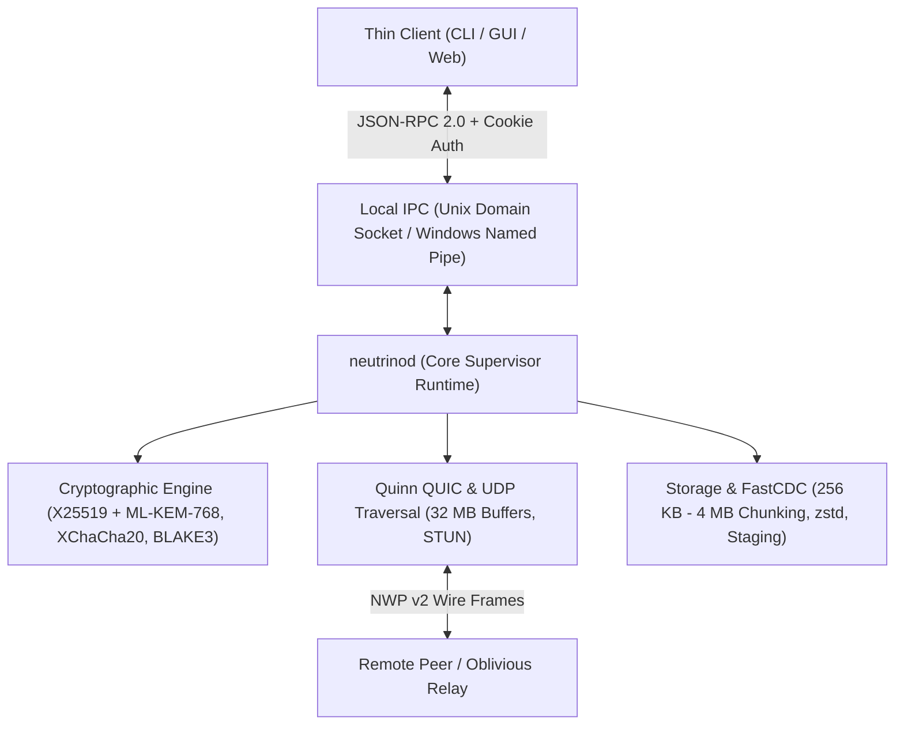

## Overview

**Neutrino v2** is a daemon-first peer-to-peer transport fabric engineered to bypass centralized cloud storage, eliminate intermediary surveillance, and achieve physical line-rate throughput across direct UDP and QUIC connections.

Whether streaming multi-gigabyte disk images directly between workstations, synchronizing distributed project folders across decentralized teams, cloning Git repositories without centralized hosts, or establishing point-to-point virtual mesh tunnels, Neutrino provides cryptographic zero-knowledge guarantees with post-quantum forward secrecy.

---

## Core Capabilities

<CardGroup cols={2}>
  <Card title="Ephemeral File Beam" icon="bolt" href="/guide/file-beam">
    Direct, zero-cloud disk-to-disk file streaming via UDP NAT hole punching and QUIC, protected by bit-perfect BLAKE3 tree-hashes and an authenticated 16 MB sliding window flow-control loop.
  </Card>
  <Card title="Multi-Host Swarm Sync" icon="arrows-rotate" href="/guide/swarm-sync">
    Continuous folder synchronization powered by FastCDC (v2020), BLAKE3 Merkle-DAG state tracking, SQLite WAL metadata, and deterministic Last-Write-Wins (LWW) conflict branching.
  </Card>
  <Card title="Singularity Git" icon="code-branch" href="/guide/singularity-git">
    Serverless, peer-to-peer Git replication (`git-remote-neutrino`) using virtual multiplexed packfile streams and cryptographic Ed25519 push access control lists (ACLs).
  </Card>
  <Card title="Virtual Mesh Tunnel" icon="network-wired" href="/guide/mesh-vpn">
    Encrypted ad-hoc virtual network interfaces (TUN/Wintun) operating with 1,420 MTU and RFC 9221 QUIC datagram multiplexing over the `10.42.0.0/24` subnet.
  </Card>
</CardGroup>

---

## Architectural Invariants

Every subsystem in Neutrino is designed around three strict non-negotiable principles:

1. **Daemon-First Decoupling**: All network sockets, cryptographic operations, disk I/O, and sync tracking live inside `neutrinod`. User-facing interfaces (the `neutrino` CLI, desktop Tauri GUI, and web portal) are thin clients that communicate via JSON-RPC 2.0 over local IPC.
2. **Cryptographic Zero-Knowledge**: Payloads are sealed client-side before touching network buffers. Signaling coordinators and fallback relays handle only keyed BLAKE3 hashes of session tokens, remaining completely blind to file metadata, identity keys, and content.
3. **High-Throughput Buffer Discipline**: Outbound UDP streaming strictly respects an authenticated 16 MB sliding window cap, preventing kernel socket buffer overflows and Quinn stream buffer gaps. Sockets are pre-tuned to 32 MB buffers (`SO_RCVBUF` / `SO_SNDBUF`).
