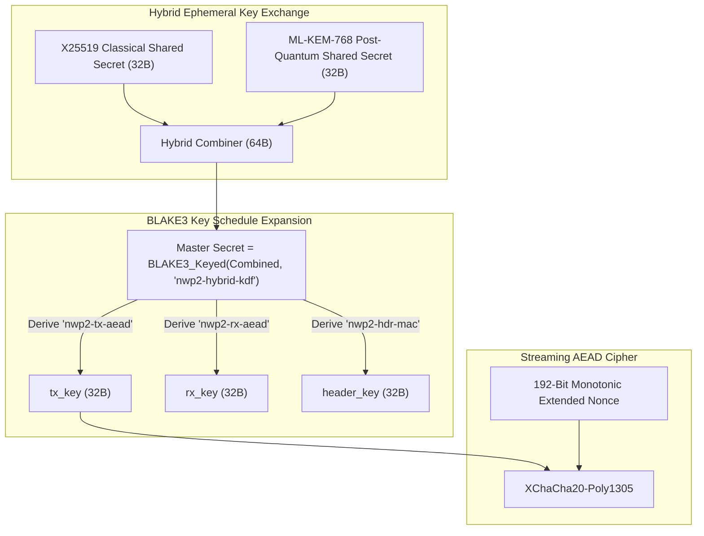

## Cryptographic Guarantees

Neutrino v2 employs a hybrid post-quantum cryptographic pipeline designed to withstand both classical cryptanalysis and future quantum adversaries equipped with Shor's algorithm.



---

## 1. Long-Term Identity & Mutual Authentication

Every Neutrino node maintains an **Ed25519** identity keypair:
* **Storage**: Encrypted PKCS#8 PEM on disk at `~/.neutrino/identity.key`, locked with an Argon2id key derived from a local passphrase.
* **Handshake Authentication**: During `HANDSHAKE_INIT` and `HANDSHAKE_RESP`, endpoints exchange signed nonces. This guarantees peer identity and prevents Machine-in-the-Middle (MITM) attacks while keeping network packets oblivious to observers.

---

## 2. Hybrid Post-Quantum Key Exchange

Neutrino avoids relying solely on post-quantum or classical algorithms by combining both:

1. **Classical ECDH**: Ephemeral **X25519** key exchange (Curve25519).
2. **Post-Quantum KEM**: NIST-standardized **ML-KEM-768** (FIPS 203 / Kyber).

The two resulting 32-byte shared secrets are concatenated into a 64-byte intermediate entropy pool:

$$\text{Intermediate} = \text{Secret}_{\text{X25519}} \parallel \text{Secret}_{\text{ML-KEM-768}}$$

Even in the hypothetical event that ML-KEM-768 is compromised, security defaults back to classical X25519. Conversely, if quantum computers break discrete logarithms, ML-KEM-768 maintains complete secrecy.

---

## 3. BLAKE3 HKDF Key Expansion

The 64-byte hybrid intermediate is expanded using domain-separated BLAKE3 key derivation:

```rust
// Master Secret Derivation
let master_secret = blake3::keyed_hash(
    b"nwp2-hybrid-kdf-master-secret-v1",
    &intermediate_pool,
);

// Domain-Separated Directional Keys
let tx_key     = blake3::derive_key("nwp2-tx-aead-v1", master_secret.as_bytes());
let rx_key     = blake3::derive_key("nwp2-rx-aead-v1", master_secret.as_bytes());
let header_key = blake3::derive_key("nwp2-hdr-mac-v1", master_secret.as_bytes());
```

---

## 4. 192-Bit Extended Nonce Schedule

To guarantee that a nonce is never repeated under the same key across millions of chunks, Neutrino uses **XChaCha20-Poly1305** with a deterministic 192-bit (24-byte) nonce:

```text
 0                   1                   2                   3
 0 1 2 3 4 5 6 7 8 9 0 1 2 3 4 5 6 7 8 9 0 1 2 3 4 5 6 7 8 9 0 1
+-+-+-+-+-+-+-+-+-+-+-+-+-+-+-+-+-+-+-+-+-+-+-+-+-+-+-+-+-+-+-+-+
|                 Session Prefix (64 bits)                      |
|                                                               |
+-+-+-+-+-+-+-+-+-+-+-+-+-+-+-+-+-+-+-+-+-+-+-+-+-+-+-+-+-+-+-+-+
|          Stream ID (16 bits)  |  Block Counter (Upper 16 bits)|
+-+-+-+-+-+-+-+-+-+-+-+-+-+-+-+-+-+-+-+-+-+-+-+-+-+-+-+-+-+-+-+-+
|                 Sequence Counter (64 bits)                    |
|                                                               |
+-+-+-+-+-+-+-+-+-+-+-+-+-+-+-+-+-+-+-+-+-+-+-+-+-+-+-+-+-+-+-+-+
|                 Block Counter (Lower 32 bits)                 |
+-+-+-+-+-+-+-+-+-+-+-+-+-+-+-+-+-+-+-+-+-+-+-+-+-+-+-+-+-+-+-+-+
```

An internal atomic counter strictly prevents counter rollover ($> 2^{64}-1$), triggering an immediate graceful re-key or session teardown.

---

## 5. Memory Zeroization

All private key material, ephemeral private scalars, KEM decapsulation keys, and intermediate derivation secrets are wrapped in `zeroize::ZeroizeOnDrop`. When any cryptographic structure goes out of scope, the memory buffers are securely scrubbed with zeroes before deallocation.
