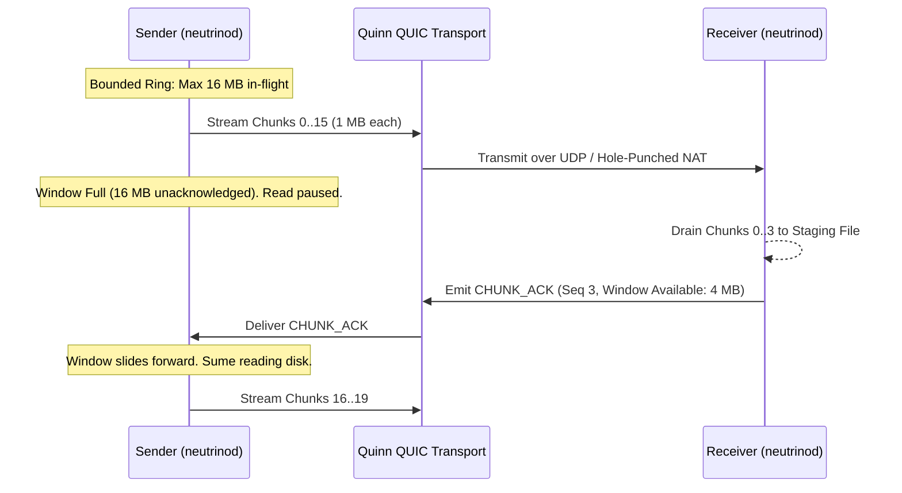

## The Line-Rate Challenge

High-speed UDP and QUIC transfers across high-bandwidth, high-latency links (e.g. 10 Gbps cross-continental transits) encounter two severe failure modes:
1. **Quinn Stream Gap Crashes**: In unconstrained out-of-order delivery, Quinn throws `INTERNAL_ERROR: "too many gaps in stream buffer"` when dropped packets fragment the reassembly ring.
2. **Kernel Socket Drops**: Under physical line rates, default OS socket buffers (typically 212 KB on Linux or 64 KB on Windows) overflow within milliseconds, causing cascading packet drops and congestion window collapses.

Neutrino v2 solves both problems with an explicit, coordinated buffer hierarchy.

---

## 1. The 16 MB Sliding Window

Neutrino places an authenticated, hard-capped 16 MB sliding window above the QUIC transport layer:



* **Window Cap**: Unacknowledged in-flight payload $\le 16\text{ MB}$ (16 chunks @ 1 MB target).
* **Receiver Cadence**: Receiver emits `CHUNK_ACK` every 4 received chunks or every 4 MB drained to disk.
* **Bounded RSS**: Bounded memory is a design goal. Large-file and sustained memory limits require reproducible end-to-end verification; existing beta measurements do not prove a universal 128 MB ceiling.

---

## 2. 32 MB Kernel Socket Buffers

Before initializing Quinn endpoints, Neutrino configures low-level socket options via `socket2`:

```rust
use socket2::{Socket, Domain, Type, Protocol};

let socket = Socket::new(Domain::IPV4, Type::DGRAM, Some(Protocol::UDP))?;
socket.set_recv_buffer_size(33_554_432)?; // 32 MB SO_RCVBUF
socket.set_send_buffer_size(33_554_432)?; // 32 MB SO_SNDBUF
socket.set_nonblocking(true)?;
```

This ensures that momentary CPU scheduling jitter on the receiver will not drop arriving bursts of UDP packets.

---

## 3. FastCDC & Entropy Classification

Data streams through the **FastCDC v2020** chunking engine:

| Parameter | Size | Purpose |
| :--- | :--- | :--- |
| **Minimum Chunk** | 256 KB | Prevents packet flood overhead on small cutpoints. |
| **Average Chunk** | 1 MB | Optimal target for 16 MB window and NVMe disk staging. |
| **Maximum Chunk** | 4 MB | Hard ceiling preventing memory bloat on low-entropy uniform blocks. |

### 4 KB Shannon Entropy Classifier

Compressing already-compressed data (e.g., `.mp4`, `.zip`, `.zst`, or encrypted blobs) wastes significant CPU cycles. Neutrino computes the Shannon entropy over an initial 4 KB sample of each chunk:

$$H(X) = -\sum_{i=1}^{n} P(x_i) \log_2 P(x_i)$$

* **$H(X) \ge 7.9$**: Marked incompressible. Bypasses `zstd` entirely, preserving CPU cycles for encryption and transport.
* **$H(X) < 7.9$**: Marked compressible. Passed through streaming `zstd` level 3 and tagged with `Flags::COMPRESSED` (`0x01`).

---

## 4. Pre-Flight Storage Allocation

To prevent catastrophic out-of-space halts during multi-gigabyte transfers:
1. Receiver extracts total payload length from `TRANSFER_MANIFEST`.
2. Inspects target filesystem headroom via `fs2::available_space`.
3. Calls `fs2::FileExt::allocate` (`fallocate` on Linux, `SetFileValidData` on Windows) to pre-allocate continuous disk blocks, eliminating fragmentation and guaranteeing that transfers never fail mid-stream due to `ENOSPC`.
